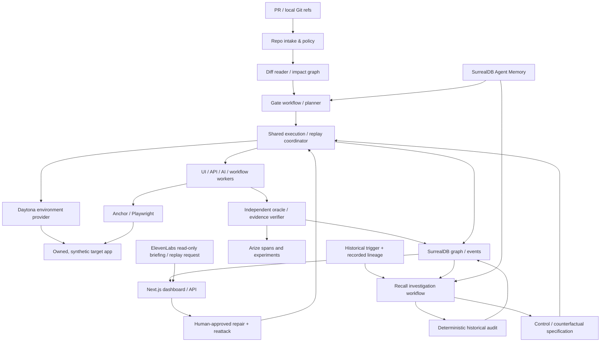

# GAUNTLET — Unified Development Blueprint and AI-Agent Handoff

**Edition:** 3.0 · **Prepared:** 2026-10-14 · **Status:** architecture / implementation starter, **not** an implemented production system  
**Project:** Gauntlet Gate + Gauntlet Recall · **Team:** exactly three collaborators  
**Primary source inputs:** `Gauntlet.md` (Gauntlet v2 agent-engineering handoff) and `Gauntlet + Recall — Design Doc.md` (historical impact audit and replay workflow).  
**Companion artifacts:** `gauntlet-unified-starter/` and its ZIP contain individually named, editable documentation, working contract/healthcheck scaffolding, and test examples. **This Markdown is the authoritative development roadmap**; `docs/DECISIONS.md` records architecture changes.

> **Product thesis:** Gauntlet understands software changes, invents relevant adversarial tests, executes them safely, verifies failures and fixes, and—when a problem may already be live—investigates historical exposure and the impact on recorded AI decisions.
>
> **Two product modes:** **Gate** (before release) and **Recall** (after a defect or bad input is discovered). They share evidence, replay, sandbox and memory infrastructure, but have **different triggers, adjudicators and verdicts**.

## 0. Read this first — how an AI coding harness should use this package

1. Read this file, `README.md`, `AGENTS.md`, `CONTRIBUTING.md`, `docs/OWNERSHIP.md`, and the applicable `docs/PHASES.md` section in that order. Read `CLAUDE.md` or `CODEX.md` if relevant. Follow the stricter safety rule in case of conflict.
2. **Do not implement everything at once.** Work in dependency-ordered phases (Section 16), stop after each acceptance gate, and present tests/evidence. A new phase may proceed only when its prerequisites pass.
3. Use the target tree in Section 6. Do not invent new services or move directories without an approved architecture decision record (ADR).
4. **Freeze shared contracts before parallel implementation.** A owns model definitions; B and C review. After freeze, each collaborator edits only their assigned path. Consumer stubs/mocks unblock parallel work.
5. **No fictional success.** External provider access, sandbox creation, fork correctness, trace export, memory retrieval and browser sessions must be smoke-tested. The included scaffolding does not establish those integrations.
6. **Never promote a model opinion to a confirmed bug.** Only an independent, authorized oracle with reproduction evidence can do so.
7. `bench/private/` must be located outside any analysis, attacker or fixer checkout at runtime. `.gitignore` alone is not an isolation mechanism.
8. Every agent finishing a task reports: files changed, commands run, test results, contract changes, remaining blockers and the next smallest task. An agent may never silently edit protected files.
9. **The master plan is a plan; the starter package is scaffolding.** Actual vendor SDK calls must be implemented and verified by the assigned owner.

### What is decided versus still to validate

**Chosen defaults:** Python 3.12 + FastAPI/Pydantic v2/uv for control plane; TypeScript strict + Next.js and pnpm for dashboard; TypeScript/Next.js demo target and a small API; SurrealDB core for event graph; SurrealDB Agent Memory for typed temporal memory; Daytona for isolation; Anchor + Playwright for UI; Arize AX/OpenInference for trace/evals; AWS Bedrock for planner and test agents; ElevenLabs for voice. Prefer **one modular backend**, not microservices.

**Must validate with live SDKs:** exact package releases, Daytona Linux VM fork availability and quotas, signed previews and browser networking, Anchor session APIs/recording format, Arize experiment SDK version, SurrealDB core vs Agent Memory endpoint setup, Bedrock model ID/access, ElevenLabs tool/webhook configuration. Record the chosen versions in `docs/SDK_VALIDATION.md` and commit both lockfiles. Do not imply a specific provider grants free credits or access merely because it is in the design.

**Product boundary:** Gauntlet does not guarantee all bugs are found, does not scan arbitrary public sites, does not rewrite/merge code without authorized approvals, and cannot recover historical decisions whose inputs/state were never recorded. No real payments, production calls, or customer notifications during test/replay.

---

## 1. Consolidated product definition

### 1.1 Gate — before release

Input: authorized repository ID, base/head SHAs, a target manifest, feature intent and scoped policy. Gate explores the actual diff and adjacent code, builds an impact map, pulls relevant verified regression memory, proposes **versioned structured hypotheses** and chooses workers. It provisions equivalent base/head environments and executes relevant browser, API, concurrency or AI-tool probes. An independent verifier checks deterministic oracles, replay and baseline attribution. A human approves the fix plan and later reviews the release verdict. A verified scenario becomes reusable memory.

**The promise is change-aware exploration and verified behavior**, not a magic prompt that can prove arbitrary software correct. A CSS PR and a tool-authorization PR must result in meaningfully different test plans.

### 1.2 Recall — after discovery

Input: an incident trigger (`finding`, `document`, `memory`, `model_version`, `prompt_version`, `policy_version`, `tool_result_window`), incident interval, historical log/snapshot coverage, investigation scope and reviewer approval. Recall traverses historical provenance and performs one of two valid procedures:

- **Mode `event_audit`:** deterministic audit of logged operations and recorded authoritative state; identifies confirmed violations where evidence is sufficient. Example: an unauthorized refund operation recorded for an actor/order pair. This is *not* an LLM counterfactual.
- **Mode `decision_counterfactual`:** reproduces a historical agent outcome in a control replay using the historical inputs/config/tool outputs; then removes or replaces the implicated input and reruns in an isolated sandbox. An exposed decision is `tainted` **only if** control reproduces the historical outcome and the counterfactual materially changes it, under the defined criterion. Otherwise `cleared`, `inconclusive` or `not_replayable`.

The resulting queue contains cases to investigate, evidence, confidence/limitations and proposed human-approved remediation. **Exposure ≠ harm**; neither read access nor a mismatch automatically establishes money lost or who received a refund. Actual financial destination/outcome requires payment/ledger evidence.

### 1.3 The differentiating closed loop

`Change → Risk hypotheses → Safe attacks → Independent proof → Approved patch → Replay/regression → Regression memory → Future Gate` plus `Finding or bad-input discovery → Historical lineage → Audit/control/counterfactual → Review queue → Fix tests → Regression memory`.

Memory must be provenance-backed, typed, time-aware and shared across planner, verifier and investigator. It should not be just vector search over free-form bug summaries.

### 1.4 Core scenarios, not a product limitation

**UI PR:** add a floating Help button. The diff (not the prompt) contains fixed positioning; Gauntlet independently decides to test viewport and occlusion, finds Checkout impossible to click at a narrow width, checks base vs head and verifies a CSS patch preserves both controls.

**AI/tool PR:** add `request_refund` to a support assistant. Gauntlet explores the tool implementation/permissions, tests adversarial messages and untrusted retrieved content using synthetic identities, confirms a forbidden side effect via the tool gateway and ledger, then verifies a server-side owner check preserves legitimate refund behavior.

**Recall (existing code):** a refund authorization bug predates the PR. Historical `start_refund` events are audited; only actual unauthorized successful side effects are classified as confirmed violations, and replay verifies the proposed patch. **Recall (agent-memory poison):** a discovered bad policy chunk and derived memory entry lead to lineage traversal and control/counterfactual replays of affected decisions. Both modes share replay/sandbox/evidence but not claims of causality.

---

## 2. Non-negotiable invariants

| Invariant | Enforcement / acceptance evidence |
|---|---|
| Explicit authorized targets only | Server-issued `target_id`, repository allowlist, network/DNS egress policy, redirected URL validation, synthetic test actors |
| No model-only confirmed finding | Trusted oracle registry + frozen spec + oracle evidence + repeated reproduction |
| Distinguish new vs existing | Same test/fixtures on base/head; `introduced/pre_existing/unknown` separate from violation |
| Freeze plans before tool execution | `plan_hash` and timestamp persisted before attempts; append-only evidence |
| Attackers cannot alter scoring | Oracles, hidden truth and trusted fixtures outside attacker mount; read-only trusted API |
| Fix cannot fake success | Patch allowlist; protected tests/oracles not writable; original + variants + legitimate regression tests |
| Historical claims require coverage | Historical instrumentation manifest, gaps, state checksums and `not_replayable`/`inconclusive` handling |
| No automatic real-world effects | Voice cannot approve merge; reports cannot issue production transactions; reviewer ID + plan hash for sensitive actions |
| Temporal memory is auditable | Provenance, supersession rather than destructive overwrite, `known_at` and `valid_from/until`, recall-as-of tests |
| Honest run results | Coverage per worker and target; incomplete/unsupported != passed; recorded vs live clearly labeled |

---

## 3. Architecture: hexagonal ports/adapters + two workflows



**Control plane:** FastAPI application, auth/scope, trusted oracles, credentials, event and approval persistence, decision lineage metadata. **Test plane:** disposable Daytona runtimes with app code and synthetic fixtures only. **Browser plane:** Anchor cloud browser with allowed preview URLs only; Playwright CDP for deterministic interactions. **Replay plane:** controlled historical states and recorded tool outputs, isolated side-effect sinks, ephemeral sandboxes. **Evidence plane:** immutable JSON logs and sanitized screenshots/videos under `artifacts/<run>/<attempt>`; SurrealDB stores IDs, hashes/links; Arize stores correlated traces/eval outputs.

### 3.1 Critical shared interfaces

Use small Python `typing.Protocol` ports injected through a composition root; do **not** leak vendor SDK objects into domain code. Ports: `RepositoryInspector`, `ImpactMapper`, `ModelGateway`, `AttackPlanner`, `SandboxProvider`, `BrowserProvider`, `TestWorker`, `TrustedOracleRegistry`, `Verifier`, `ArtifactStore`, `RunStore`, `HistoricalEventStore`, `LineageStore`, `MemoryPort`, `ReplayEngine`, `RepairExecutor`, `ApprovalStore`, `TracePort`, `VoiceBriefingPort`.

**Concrete objects**: `GitRepositoryInspector`, `BedrockModelGateway`, `DaytonaSandboxProvider`, `AnchorBrowserProvider`, `SurrealRunStore`, `SurrealAgentMemoryAdapter`, `ArizeTraceAdapter`, `ElevenLabsBriefingAdapter`. Prefer composition over a deep hierarchy. Pure domain policy is implemented with dataclasses/functions; Pydantic is for serialized boundaries. `RunCoordinator` is an application service with injected ports and explicit state machine—not an LLM agent.

**Workflow separation:** `GateCoordinator` owns diff/attack/PR attribution and Gate verdicts. `RecallCoordinator` owns trigger/lineage/coverage/classification. `ReplayService` and `EnvironmentManager` are reused, but accept **typed execution specs** rather than mode-specific branching hidden in SDK adapters. New workers register capability metadata and a stable result schema.

### 3.2 Replay invariants and reproducibility

A replay spec must pin: `source_sha`, `image_digest`, `fixture_id`+checksum, `agent_model_id`, `prompt_version`, `policy_version`, `tool_schema_hash`, `kb_snapshot_hash`, `memory_snapshot_hash`, `input_messages_hash`, recorded tool outputs, logical timestamp, seed, external-effect mock configuration, and expected decision ID (when historical). Store why any field is unavailable.

**Gate variant:** same scenario against base, head, then patch. **Recall `event_audit` variant:** replay approved historical *tool operation* against patched business logic and prove good/bad action constraints. **Recall counterfactual:** (A) original recorded result, (B) control replay retaining suspect input, (C) counterfactual with precisely that input removed/replaced, (D) fix candidate + clean regression set. Only accept counterfactual taint when control matches original; running at temperature 0 alone does not establish determinism. Repeat ambiguous LLM cases and report distributions.

**Daytona semantics:** current docs show `Daytona().create()` and `sandbox.fork()`; forks are supported for VM sandbox classes, **not container sandboxes**. Cold snapshot/reseed is the fallback; a filesystem clone never automatically freezes external DB/API state. Always check health and fixture/state checksum before comparing. Do not present fake parallel forks if only separate sandboxes were created.

### 3.3 Lifecycle state machines

Gate: `created → intake → impact_mapped → planned → scope_pending → provisioning → executing → verifying → findings_ready → [fix_pending → approved → patching → retesting] → release_review → ready_for_review|held|inconclusive`; cancellation/error possible at every active state. No released-to-production transition.

Recall: `created → trigger_validated → lineage_scoped → scope_pending → [auditing|building_replay_specs] → [replaying_control → replaying_counterfactual] → classifying → remediation_drafts → review_pending → reviewed|closed`; `partial`, `not_replayable` and `failed` are explicit terminal/summary states. Historical record is immutable; replay writes new verdict/evidence rows.

Every transition is an atomic compare-and-swap, with append-only `event_id`, UTC timestamp, monotonic `sequence`, actor and idempotency key. Cancellation tears down sandboxes/browser sessions; orphan cleanup is retried by a janitor. A process-local background job is acceptable in the first vertical slice **if labeled non-durable**; production uses a durable queue.

---

## 4. Domain-driven module boundaries and OOP details

| Layer | Responsibility | Can depend on | Must not depend on |
|---|---|---|---|
| `domain/` | Value objects, status transition tables, severity and replay classification rules | stdlib | FastAPI, any provider SDK, environment vars |
| `contracts/` | Pydantic v2 public DTOs + schema validation | Pydantic, enums | Provider response classes, mutable globals |
| `ports/` | Async Protocol contracts and TypedDict/DTO boundaries | `contracts`, `domain` | Concrete adapters |
| `application/gate/` | Gate use cases, approvals, budgets, coordination | ports, domain | Vendor SDK calls |
| `application/recall/` | Historical scope, audit/counterfactual orchestration | ports, domain | UI, vendor-specific storage queries |
| `analysis/` | Read-only Git tooling, impact map, code exploration | repo read port, contracts | Arbitrary filesystem/shell execution |
| `planning/` | Prompt templates, bounded tool selection, output validation | ModelGateway, read-only tool registry | Oracle writes |
| `workers/` | UI/API/agent attempts, typed observations | Browser/API ports | Trusted verdict assignment |
| `verification/` | Registered hard oracles, base/head comparison, reproduction | immutable oracles, recorded observations | LLM-authored pass/fail |
| `execution/` | Sandbox lifecycle, replay and side-effect isolation | SandboxProvider and ReplaySpec | Business adjudication |
| `repair/` | Scoped diff proposals, approval hash, patch and regression | trusted verifier, approved writable tree | Hidden benchmark, trusted oracles |
| `persistence/` | SurrealDB core graph, event log, immutable approvals | domain IDs, adapters | Business interpretation of raw data |
| `memory/` | Typed/time-aware Agent Memory gateway and retrieval policy | MemoryPort | Inferring facts from unverified memories |
| `integrations/` | Provider SDK adapters with timeouts/retries/telemetry | ports | Domain decision policy |
| `api/` | FastAPI dependency injection, REST/SSE, authorization | application use cases | SQL or raw provider objects |
| `apps/dashboard/` | Presentation and operator review | generated API client | Server-side credentials and validation ownership |
| `apps/cartwheel/` | Synthetic target + seeded benchmark scenarios | target-local services | Trusted score/hidden truth read access |

### Interface sketches (normative internal interfaces; *not* claims about vendor APIs)

```python
from typing import Protocol, Sequence
from gauntlet.contracts import ChangeRequest, ChangeImpactMap, AttackSpec, Observation, ReplaySpec, ReplayResult, Finding

class RepositoryInspector(Protocol):
    async def inspect_change(self, change: ChangeRequest) -> ChangeImpactMap: ...
    async def read_source(self, repo_id: str, sha: str, path: str, start: int, end: int) -> str: ...

class SandboxProvider(Protocol):
    async def create(self, *, source_sha: str, fixture_id: str, mode: str) -> str: ...
    async def verify_fixture(self, environment_id: str, checksum: str) -> bool: ...
    async def destroy(self, environment_id: str) -> None: ...

class TestWorker(Protocol):
    kind: str
    async def run(self, spec: AttackSpec, environment_id: str) -> Observation: ...

class ReplayEngine(Protocol):
    async def replay(self, spec: ReplaySpec) -> ReplayResult: ...

class RunStore(Protocol):
    async def append_event(self, run_id: str, event: dict) -> None: ...
    async def get_event_stream(self, run_id: str, after_sequence: int) -> Sequence[dict]: ...

class TrustedOracleRegistry(Protocol):
    def validate_id(self, oracle_id: str) -> bool: ...
    def evaluate(self, oracle_id: str, observation: Observation) -> dict: ...
```

Adapters must normalize provider records into **serialized, strict, versioned DTOs**. `extra="forbid"`, bounded lists/string lengths, UTC timestamps, no arbitrary user-supplied code paths or shell commands. Avoid `Any` outside adapter boundaries. No unbounded LLM-generated JSON dicts as executable steps. Multi-step browser actions are a discriminated union (`navigate`, `resize`, `click`, `scroll`, `type`, `press`, `inspect`, `capture`), validated before dispatch.

---

## 5. Machine-readable contracts — freeze these before parallel work

**Authority:** `services/gauntlet/src/gauntlet/contracts/` is canonical; export JSON Schema to `packages/contracts/jsonschema/` and OpenAPI from FastAPI. Generate the dashboard client from `packages/contracts/openapi/gauntlet.v1.json`. Do not hand-edit generated TypeScript. Every wire model has `schema_version: "1.0"`; breaking changes require `v2` and an ADR.

**Common IDs:** UUID/ULID string in HTTP; provider record IDs mapped only by adapters. Every event includes `run_id`, `event_id`, `sequence`, `created_at` UTC, `actor`, `trace_id?`, `snapshot_id?`, `schema_version`. Evidence refs have `sha256`, media type, sanitized location and provenance. JSON goldens (`docs/contracts/examples/`) form consumer/provider compatibility tests.

| Contract | Mandatory fields |
|---|---|
| `ChangeRequest` | `repository_id`, `base_sha`, `head_sha`, `fixture_id`, `target_id`, `feature_intent?`, `max_cost` |
| `SourceRef` | `path`, `sha`, `start_line`, `end_line`, `content_hash?` |
| `ChangeImpactMap` | `base_sha`, `head_sha`, `changed_files`, `surfaces` (component/route/api/tool/style), `source_refs`, `coverage_gaps` |
| `AttackSpec` | `attack_id`, `hypothesis`, `why_this_change`, `source_refs`, `worker_kind`, `target_id`, `fixture_id`, discriminated `steps`, `oracle_ids`, budgets |
| `Observation` | `attack_id`, `environment_id`, `action_log`, raw metrics, state diff, tool calls, evidence refs, status |
| `OracleVerdict` | `oracle_id`, `outcome=pass|fail|inconclusive`, `criterion_version`, `observed`, `expected`, evidence refs |
| `Finding` | `status`, `attribution`, `severity`, `head/base replay counts`, oracle verdicts, trace/evidence IDs, repro manifest |
| `ReplaySpec` | `mode=gate_compare|historical_control|historical_counterfactual|fix_regression|event_audit`, pinned hashes, recorded input/tool outcomes, mutation description, budget |
| `ReplayResult` | replay status, reproduction/coverage, structured outcome, `state_hash_before/after`, trace/evidence links |
| `HistoricalDecision` | agent/prompt/model versions, tools, KB/memory provenance, actor, structured outcome, timestamps and hashes |
| `RecallTrigger` | `kind`, `reference`, incident window, data-coverage manifest, scope boundaries |
| `ExposureRecord` | decision/event ID, direct vs multi-hop lineage, source path(s), provenance refs |
| `RecallVerdict` | `audit_violation|audit_clear|tainted|cleared|inconclusive|not_replayable`, rationale, oracle/version, control_matches?, material_delta?, links |
| `RemediationProposal` | affected cases, proposed action, policy/case evidence, approver identity, never executed automatically |
| `TemporalMemoryFact` | typed mechanism, value, source_refs, known_at, valid_from, valid_until?, confidence, supersedes?, trust |

### 5.1 Verdict boundaries

- Gate: `confirmed_regression` requires **head failure + base pass + trusted oracle + reproduction**. `confirmed_pre_existing` requires failures on both. `confirmed_policy_violation` may have attribution `introduced|pre_existing|unknown`; do not equate policy failure with PR attribution. Other statuses: `suspected`, `not_reproducible`, `environment_error`, `passed`, `not_tested`.
- Recall audit: `audit_violation` requires complete relevant logs + actual forbidden result/state, not a caller mismatch alone. `audit_clear` requires sufficient evidence; otherwise `inconclusive`.
- Recall counterfactual: `tainted` requires a matching control, valid replay environment and a material change. `cleared` requires matching control and no material change. `not_replayable` for missing critical history; `inconclusive` for control mismatch, nondeterminism, or uncertain semantics.
- Never reduce aggregate report to a single green badge. Include per-worker test coverage, scope gaps, data completeness, replica mismatch and skipped cases.

### 5.2 API v1 surface (planned contract; implement route-by-route)

| Method | Path | Purpose | Ownership |
|---|---|---|---|
| `GET` | `/health` | Control API readiness, no vendor secrets | C |
| `POST` | `/v1/gate/runs` | Starts authorized Gate run, returns 202/job ID | C route / A service |
| `GET` | `/v1/gate/runs/{run_id}` | Status, cost, coverage, rollout mode | C |
| `GET` | `/v1/gate/runs/{run_id}/impact` | Evidence-linked change map | C |
| `GET` | `/v1/gate/runs/{run_id}/plans` | Frozen hypotheses/specs, before execution | C |
| `GET` | `/v1/gate/runs/{run_id}/findings` | Objective evidence + attribution | C |
| `POST` | `/v1/gate/runs/{run_id}/scope-approval` | Human-approved exact scope | C |
| `POST` | `/v1/findings/{finding_id}/fix-plans` | Draft bounded fix proposal | C / A orchestration |
| `POST` | `/v1/fix-plans/{id}/approve` | Approve/reject immutable `plan_hash` | C |
| `POST` | `/v1/fix-plans/{id}/apply` | Sandbox patch job, never production | C |
| `GET` | `/v1/fixes/{fix_id}/verification` | Replay + clean-regression evidence | C |
| `POST` | `/v1/recalls` | Initiate triggered Recall with mode and scope | C route / A service |
| `POST` | `/v1/recalls/{id}/scope-approval` | Confirm history range and source coverage | C |
| `GET` | `/v1/recalls/{id}/exposures` | Direct/indirect lineage and missing coverage | C |
| `GET` | `/v1/recalls/{id}/verdicts` | Audited/tainted/cleared/inconclusive | C |
| `GET` | `/v1/recalls/{id}/remediation` | Draft action queue for human review | C |
| `POST` | `/v1/remediations/{id}/approve` | Audit reviewer approval only, not execution | C |
| `GET` | `/v1/runs/{id}/events` | Resumable SSE ordered by persisted sequence | C |
| `GET` | `/v1/artifacts/{id}` | Authorized short-lived artifact URL | C |
| `GET` | `/v1/voice/tools/summary` | Restricted summary payload for ElevenLabs | C |
| `POST` | `/v1/voice/tools/replay-request` | Authorized re-test request; **no merge** | C |

`POST` side effects need request idempotency keys, auth scopes, rate limits and audit records. Event stream `Last-Event-ID` maps to persisted sequence; browser reconnect deduplicates. `GET /health` does not imply all sponsor services are ready; `GET /ready` can report service availability without secrets. Use OpenAPI and route contract tests before connecting UI.

---

## 6. Target monorepo and per-file ownership

**Ownership shorthand:** A = intelligence/domain/contracts; B = execution/verification/providers/data; C = fixture/dashboard/API-composition/dev experience. Only the path owner writes normal feature code. Cross-boundary requests are small contract PRs approved by all three. Only C edits root shared configuration after initial freeze.

```text
gauntlet/
├── README.md                         [C] setup, architecture map, truthful status
├── CONTRIBUTING.md                   [C] branching, review, conflicts, testing
├── AGENTS.md                         [C] authoritative universal harness instructions
├── CLAUDE.md                         [C] Claude-specific wrapper, points to AGENTS.md
├── CODEX.md                          [C] Codex-specific wrapper, points to AGENTS.md
├── .editorconfig .gitignore .env.example [C] common hygiene and placeholders
├── package.json pnpm-workspace.yaml pnpm-lock.yaml [C] JS workspace (lock after install)
├── pyproject.toml uv.lock             [C] Python tooling (lock after install)
├── docs/
│   ├── DESIGN.md                      [C] unified product spec
│   ├── DEVELOPMENT_PLAN.md            [C] this file
│   ├── ARCHITECTURE.md                [A] diagrams, trust planes and boundaries
│   ├── CONTRACTS.md                   [A] authoritative schema notes
│   ├── OWNERSHIP.md                   [C] paths + reviewer map
│   ├── PHASES.md                      [C] ordered tickets, gates, evidence
│   ├── SDK_VALIDATION.md              [B] verified API versions, smoke results
│   ├── SECURITY.md                    [B] threat model/egress/permissions
│   ├── MEMORY.md                      [B] typed/temporal memory and graph schema
│   ├── RECALL.md                      [A] historical audit/counterfactual spec
│   ├── BENCHMARK.md                   [B] held-out scoring/provenance
│   ├── RUNBOOK.md                     [C] local setup, reset, incident drill
│   ├── DEMO.md                        [C] three-act demo and video/Devpost guide
│   ├── DECISIONS.md                   [C] architecture decision index
│   ├── adr/0001-*.md                  [C] numbered ADRs, coordinated reviews
│   ├── prompts/{planner,investigator,fixer}.v1.md [A] versioned prompts
│   └── contracts/examples/            [A] frozen golden request/response JSON
├── services/gauntlet/
│   ├── pyproject.toml                 [C] package entry and python dependencies
│   ├── src/gauntlet/
│   │   ├── contracts/{common,gate,recall,replay,events}.py [A] DTOs
│   │   ├── domain/{policy,verdicts,state}.py           [A] pure logic
│   │   ├── ports/{repository,model,sandbox,browser,storage,replay,memory}.py [A] Protocols
│   │   ├── application/gate/{coordinator,approvals}.py [A]
│   │   ├── application/recall/{coordinator,scope,classifier}.py [A]
│   │   ├── intake/{authorization,git_refs}.py [A]
│   │   ├── analysis/{repo_reader,impact_mapper,surface_mapper}.py [A]
│   │   ├── planning/{planner,worker_selector,plan_validation}.py [A]
│   │   ├── execution/{environment_manager,replay_service,replay_specs}.py [B]
│   │   ├── workers/{registry,ui,ai_agent,api,workflow,concurrency}.py [B]
│   │   ├── verification/{oracle_registry,ui_oracles,auth_oracles,comparison}.py [B]
│   │   ├── recall/{event_audit,control_replay,counterfactual,coverage}.py [B]
│   │   ├── repair/{patch_executor,regression_runner}.py [B]
│   │   ├── integrations/{daytona,anchor,arize,surreal_core,surreal_memory,bedrock,elevenlabs}.py [B]
│   │   ├── persistence/{records,event_store,lineage_store}.py [B]
│   │   ├── memory/{types,retriever,provenance,temporal}.py [B]
│   │   ├── security/{targets,secrets,redaction}.py [B]
│   │   ├── observability/{spans,evaluations}.py [B]
│   │   ├── reporting/{gate_report,recall_report,proof_bundle}.py [C]
│   │   └── api/{main,deps,errors}.py + api/routes/{gate,recall,findings,approvals,events,voice}.py [C]
│   └── tests/{test_contracts,test_verdicts,test_recall_classification}.py [A/B scoped]
├── apps/dashboard/                   [C] Next.js App Router and generated API client
│   ├── src/app/(overview)/page.tsx
│   ├── src/app/gate/[id]/page.tsx
│   ├── src/app/recall/[id]/page.tsx
│   ├── src/components/{ImpactMap,AttackTimeline,FindingCard,RecallGraph,ReplayCompare,FixApproval,VoiceBrief}.tsx
│   └── src/lib/{api,events,formatters}/
├── apps/cartwheel/                   [C] deterministic synthetic demo target only
│   ├── web/src/{app,components,styles}/
│   ├── api/src/{routes,domain,tools,db,assistant,lineage}/
│   ├── fixtures/{public,history}/
│   └── README.md
├── packages/contracts/               [A] generated JSON Schemas and OpenAPI snapshots
│   ├── jsonschema/                  exported from Pydantic
│   └── openapi/                     generated from FastAPI
├── infra/
│   ├── daytona/                      [B] boot/start/health scripts; snapshot and fork probe
│   ├── surreal/                      [B] graph migrations, temporal memory setup
│   └── local/                        [C] Compose + dev topology
├── bench/
│   ├── public/                       [C] normal acceptance criteria, fixture manifest
│   ├── private/                      [B] evaluator-only scoring truth; no actual truth in app repo
│   └── heldout/                      [B] perturbations, independent score outputs
├── scripts/                          [C] bootstrap/check/demo; [B] `probe_*.py` only
├── .github/{workflows,ISSUE_TEMPLATE,PULL_REQUEST_TEMPLATE.md,CODEOWNERS} [C]
└── artifacts/                         runtime generated, gitignored, access-controlled
```

**Notes:** `apps/cartwheel` is named for continuity with the source designs but **is not the product's domain model**. Some nested names are target files/folders to be created during their phase, not currently implemented. Do not create empty modules with fake success handlers. Keep an explicit file status (`planned/scaffolded/implemented/tested`) in tickets.

### 6.1 No-merge-conflict discipline

- A and B work in separate services subpackages. A owns `contracts/`, `ports/`, `domain/`, `application/`, `analysis/`, `planning/`. B owns `workers/`, `execution/`, `verification/`, `recall/`, `repair/`, `integrations/`, `persistence/`, `memory/`, `security/`, `observability/`. C owns `api/`, `reporting/`, the two apps, root toolchain and docs infrastructure.
- A owns machine schemas under `packages/contracts`; B/C use generated artifacts rather than editing them. B may suggest schema changes by issue/ADR; A applies after C signs off. C alone changes `main.py` composition. B never imports `api` from `workers`.
- Each collaborator uses a dedicated Git worktree and branch `feat/a-...`, `feat/b-...`, `feat/c-...`; never share a checkout between coding agents. Small PRs merged in phase order, no direct-to-main pushes. Root dependency upgrades are batched through C.
- Commits follow Conventional Commits, e.g. `feat(gate): add bounded impact mapping` or `test(recall): cover inconclusive control replay`. Include owner/phase in PR description, not custom invalid commit scopes.
- **Review matrix:** all-three for contracts/security boundary and plan changes; A+B for oracle/replay changes; A+C for API UX; B+C for target fixtures, demos and evidence capture. Owner must not self-approve changes that weaken a security oracle or loosen target allowlist.
- On conflicting requirements: pause, write a focused ADR or contract example, obtain agreement, regenerate schemas/clients, only then resume. Never resolve by copying DTOs into another language by hand.

---

## 7. Repository inspection and adaptive planning — actual tools

The agent cannot operate with a generic prompt alone. It needs **bounded tools**, implemented by owned adapters, each returning verifiable references. Build an allowlisted `ToolRegistry`; tools are explicit permissions, not a general `exec` or `eval` interface.

| Tool / capability | Input (typed) | Result and evidence | Trust limit |
|---|---|---|---|
| `git_change_summary` | base/head SHA, repo ID | changed paths, hunks, metadata | pinned repo, no arbitrary `git -c` |
| `read_source_lines` | SHA, relative path, range | numbered source+digest | never `.env`, `bench/private`, deps, secrets; max bytes |
| `search_symbols` | pattern and file globs | bounded references | path allowlist, bounded query |
| `discover_surfaces` | impact map + manifest | route/component/API/agent tool graph | source refs required |
| `get_requirements` | fixture/approved requirement IDs | versioned acceptance/oracle descriptors | no hidden answer keys |
| `memory_retrieve` | surface+mechanism+time | provenance-backed confirmed scenarios | filter by time and trust, prevent hindsight |
| `browser_open/resize/inspect/act` | allowed preview + typed actions | DOM, geometry, screenshot/video, action log | navigation re-checks redirects/DNS |
| `api_test_request` | route template, synthetic actor, body | response and isolated fixture delta | cannot invoke real external systems |
| `assistant_test_message` | synthetic scenario + message | conversation/tool call trace and state delta | no production tools |
| `oracle_read/evaluate` | registered oracle ID | deterministic verdict + criterion ref | attacker cannot define or disable oracle |
| `artifact_record` | bytes/metadata | hashed immutable evidence ref | sanitized, never arbitrary destinations |

The planner consumes: diff summary, `ChangeImpactMap`, known requirements, registered **oracle descriptors** (not mutable code), relevant memory with provenance, capability registry, and resource budget. It outputs a strict `AttackPlan` with `why_this_change`, source citations, `oracle_ids`, allowed worker, fixture, actions and expected objective observation. Persist the plan **before execution**. An independent policy validator rejects unsupported tools, malformed paths, unknown oracles, model-provided arbitrary JS/shell and excessive budget.

**For CSS:** inspect changed styling/DOM and likely route, choose viewports, scroll positions, keyboard and hit tests. **For tools/agents:** inspect tool implementation, callsites, policy, service-side auth and data side effects; plan controlled prompt-injection, permission and fake tool-result tests. **For API:** inspect route schema and owner checks; choose synthetic cross-user requests. Only execute capabilities shipped in the registered worker set; report `not_tested` for unavailable categories.

### Trust boundary: untrusted source is not an instruction

Repository comments, issue descriptions, target site content, retrieved documents, agent replies and model tool results can include malicious instructions. They are **data** for analysis, not system policy. Restrict automatic tool-call plans with schemas and code-level allowlists. The model must not be given provider credentials or arbitrary environment configuration.

---

## 8. Workers, objective oracles and evidence

### 8.1 Worker registry

| Worker | When selected | Executor | Trusted oracle |
|---|---|---|---|
| `ui` | Styles, component, layout, button, modal | Anchor + Playwright DOM/actions | occlusion `elementFromPoint`, interaction outcome, viewport/scroll geometry, base/head |
| `accessibility` | Keyboard, ARIA, contrast, focus changes | Playwright + axe-core | WCAG rule result + keyboard focus behavior |
| `workflow` | Routes, forms, state transitions | Browser/API workflows | explicit state-machine transition invariant |
| `api` | Endpoint/schema/permissions | httpx/typed client in isolated target | schema, auth, status/side-effect invariants |
| `concurrency` | Shared mutable state, one-time actions | synchronized sessions/test requests | consistency, idempotency, ledger constraints |
| `ai_agent` | Agent prompts/tool schema/retrieval/privilege | synthetic chat or voice/test tool | real tool-call and backend authorization + policy criteria |

### 8.2 Oracle categories

**Priority 1 hard oracle** (trusted executable assertion), **Priority 2 baseline/head differential**, **Priority 3 requirement-grounded semantic judge with uncertainty and citations**, **Priority 4 model-only visual concern** (suggestion only, never release blocker). A model cannot change the trusted oracle or expected result after running an attack. When no reliable acceptance criterion exists, do not pretend it exists; mark `suspected` or request a product owner decision.

**UI occlusion verification** requires not just geometric overlap but evidence that the intended user action cannot be activated or is substantially obstructed; record browser/viewport/scroll/accessibility tree, hit target, control outcome, and baseline state. **AI tool misuse** requires unauthorized operation side effect at the trusted backend, not just the assistant verbally agreeing to do it. **Refund audit** requires source-of-truth outcome/destination to claim a financial loss, not merely an invalid caller/order relationship.

### 8.3 Evidence bundle

Every confirmed Gate finding: `finding_id`, commit hashes, impact map/source refs, frozen hypothesis/spec, fixture checksum, base/head environment IDs, action log, oracle ID/version, reproduced count/attempted count, screenshot/recording, Arize trace IDs, state diff, authorization policy, attribution and limitations. Every confirmed Recall classification additionally requires historical event lineage, recorded input hashes, replay control-match status, known gaps, counterfactual mutation, original/control/variant outcomes and materiality criterion.

**Fix acceptance**: original exploit blocked, nearby variants blocked, legitimate workflow still works, no new error in covered regression set, known test suite passes. Re-test under a clean patch SHA and immutable oracles. A flaky repro can still be legitimate, but report observed frequency. A screenshot of a proposed patch is **not proof** it worked.

---

## 9. Historical instrumentation, lineage and Recall correctness

### 9.1 Minimum event capture BEFORE an incident

To support reliable historical Recall, instrument the target agent with a `DecisionRecorder` adapter, recording: decision ID, agent/tool/model/prompt/policy/KB versions, timestamp, synthetic or consented actor reference, structured input/output, tool names and **sanitized recorded tool results**, state snapshots/hashes, retrieved KB chunk IDs/content hashes, memory read/write IDs and their source provenance, action outcome/result IDs, transaction IDs, trace IDs and snapshot reference when available.

A post-hoc scanner cannot infer unseen earlier prompt text, tool results, memory state or model version. Report missing lineage. Compliance/privacy: minimize data, retention policy, encryption, RBAC and customer data exclusion from hackathon environment. Synthetic seeds are allowed for demos; label them synthetic. A missing log is `unknown`, not safe.

### 9.2 `event_audit` procedure

`Trigger → define affected tool/version/date → query immutable historical events → follow records to authoritative state → evaluate rule at event time → classify violation / clear / insufficient evidence → replay tools against candidate fix in a clean sandbox → verify unaffected legitimate scenarios → human review queue`.

Corrected Cartwheel example: A caller/order-owner mismatch is a **potential authorization violation**; to classify harmful completed refunds, check the tool actually executed, the server authorization context, destination account and payment/credit transaction. Never assert the wrong person *received* money from a mismatch alone.

### 9.3 `decision_counterfactual` procedure

`Trigger → graph lineage scope (direct + memory-derived) → assemble historical replay spec → verify hashes and snapshot coverage → control replay with suspect source intact → compare control to original → counterfactual replay with exactly the suspect input removed/replaced → calculate material action/amount/promise delta → tainted|cleared|inconclusive → optional fix-candidate regression race → human review`.

For indirect exposure, trace: `document_chunk → retrieved_by decision → wrote memory → read_by later decision`. Also consider model/prompt versions and tool-result windows as triggers; only classify reachable decisions where provenance can be established. Similarity search suggests potential sources, but it is not proof of exposure and must be reviewed.

### 9.4 Replay reproducibility / confidence rubric

- **Strong:** relevant inputs, model/prompt/policy, KB/memory and tool returns pinned; control matches recorded outcome; counterfactual consistent on repeated runs; known materiality criterion.
- **Moderate:** control matches but some non-critical environmental metadata missing; report qualified results, never unqualified `proved` claims.
- **Inconclusive:** control mismatch, unstable outcomes, unclear external state, missing critical inputs or incomplete provenance.
- **Not replayable:** required state/input unavailable. Still preserve the known historical exposure and recommend manual review.

Temperature 0 and replayed tools reduce variation but do not eliminate it. For material free text, use an Arize LLM judge with quotes against a versioned policy and secondary human review. Financial and authorization state remains programmatic.

---

## 10. SurrealDB: core graph + typed, time-aware Agent Memory

**Separate the two offerings:** `SurrealDB core` is the operational event graph/source of persisted runs. `SurrealDB Agent Memory` is a distinct memory/context service and SDK; it is not merely the same Python client connection. Test both explicitly.

### 10.1 Core persistence

Proposed record kinds: `run`, `change_surface`, `hypothesis`, `attempt`, `observation`, `oracle_verdict`, `finding`, `fix_candidate`, `validation`, `artifact`, `approval`, `historical_decision`, `tool_event`, `source_chunk`, `memory_write`, `memory_read`, `recall_trigger`, `exposure`, `recall_verdict`, `remediation`, `run_event`. Relationships: `run->tests->surface`, `hypothesis->motivated_by->source`, `finding->verified_by->oracle`, `finding->fixed_by->fix`, `decision->retrieved->chunk`, `decision->wrote->memory`, `decision->read->memory`, `recall->affects->decision`.

Define explicit schema, indexes by `run_id`, `created_at`, `actor`, `tool`, `source_hash`, `model/prompt version`, `valid_from` and decision ID. SurrealQL examples are **conceptual** until tested on chosen SurrealDB release. Use bound parameters and migrations, not hand-interpolated model output or plaintext credentials.

### 10.2 Agent Memory sponsor differentiator

Memory facts are typed (`ui_occlusion`, `authz_bypass`, `workflow_state`, `policy_conflict`, `fix_pattern`) and have provenance (`finding_id`, `oracle_id`, repo SHA, trace/ref, verification status, source trust). Time semantics: when discovered/recorded (`known_at`) versus when behavior was valid (`valid_from/valid_until`), plus supersession linking old advice to new evidence. Share relevant memory between planner/investigator/fixer **through distinct permission lenses**, not one unrestricted context. Query `as_of` in historical benchmarks to prevent future knowledge leaking into earlier planning. Use Agent Memory's SDK `Memory`/`AsyncMemory` and the current APIs verified in docs, not a generic invented memory endpoint.

**Required memory demo:** run Gate on a first PR, store one confirmed reproducible bug with traceable source and fix. Run another related but altered PR and compare planner candidate tests with/without relevant memory. Show source citation and temporal version; demonstrate a corrected memory supersedes old advice without erasure. Recall investigator can retrieve prior *verified* incidents, never rely on memory summary alone to classify historical harm.

**Safety:** unverified model summaries stay quarantined; memory retrieved from app content remains lower trust than policy/oracle definitions. Memory retention/redaction applies to source text as well as vectors.

### 10.3 Example temporal record (app-level schema proposal)

```json
{
  "kind": "ui_occlusion",
  "fact_id": "mem-083",
  "summary": "Fixed help overlays can occlude primary mobile actions",
  "verification": "confirmed",
  "source": {"finding_id": "finding-21", "oracle_id": "ui.primary_action_reachable", "commit": "<sha>"},
  "known_at": "2026-10-14T14:00:00Z",
  "valid_from": "2026-10-14T13:55:00Z",
  "valid_until": null,
  "supersedes": null,
  "trust": "verified_test",
  "scope": "project/cartwheel/feature/ui"
}
```

---

## 11. SDKs, services, APIs and keys — implementation matrix

All API tokens are generated by the respective service owner and stored in `.env.local`/host secret manager, never in repository or prompts. **Never paste the event resource coupon codes into source, docs or tests**; redeem privately in sponsor consoles. Use least privilege and rotate leaked keys.

| Service | Python/TS package or API | Known public integration | Required configuration | Ownership / validation |
|---|---|---|---|---|
| Daytona | Python `daytona` | `Daytona().create()`, `sandbox.process.exec`, `sandbox.fork()` for eligible VM; snapshots/preview SDK | `DAYTONA_API_KEY`, `DAYTONA_API_URL?` | B verifies create/readiness/preview/fork/cleanup; VM vs container documented |
| Anchor Browser | `anchorbrowser` Python SDK + `playwright` | `client.browser.create()` or session + CDP attachment; recordings | `ANCHOR_API_KEY` | B verifies approved preview, resize/click/screenshot, closed session |
| Arize AX | `arize-otel`, OpenTelemetry, OpenInference Bedrock instrumentation; Arize Python SDK for experiments | `arize.otel.register`; dataset/experiment evaluator API (version check) | `ARIZE_API_KEY`, `ARIZE_SPACE_ID`, `ARIZE_PROJECT_NAME` | B traces planner/worker/validator and runs before/after experiment |
| SurrealDB core | `surrealdb` Python SDK | `AsyncSurreal(url)` + authenticated namespace/database + queries | `SURREAL_URL`, `SURREAL_NS`, `SURREAL_DB`, `SURREAL_USER`, `SURREAL_PASS` | B verifies graph write/query, bound params, migrations |
| SurrealDB Agent Memory | prerelease `surrealdb[memory]` / `surrealdb.memory.AsyncMemory` | `remember`, `recall`, `query_context` with context, scope/lens, temporal filters; **separate service** | `SURREAL_MEMORY_ENDPOINT`, `SURREAL_MEMORY_CONTEXT`, `SURREAL_MEMORY_API_KEY` | B tests provenance, supersession/time bounds; **SDK is prerelease**, lock version |
| AWS Bedrock | `boto3` + OpenInference Bedrock instrumentor | `bedrock-runtime.converse`; model-specific tool capability | `AWS_REGION`, `BEDROCK_MODEL_ID`, AWS profile/role or credential chain | B provider adapter; A owns ModelGateway contract. Verify model access/IAM |
| ElevenLabs | `elevenlabs` Python or official JS/React widget; server tools/webhooks | Voice agent with read-only evidence lookup, optional replay request | `ELEVENLABS_API_KEY`, `ELEVENLABS_AGENT_ID`, `VOICE_WEBHOOK_SECRET?`, `PUBLIC_BASE_URL?` | C UX/webhook; B token validation; human approval never by voice alone |
| GitHub | GitHub REST/GraphQL, App/webhook later | Pull request diff and check-runs; **local Git refs first** | `GITHUB_APP_ID`, `GITHUB_INSTALLATION_ID`, `GITHUB_PRIVATE_KEY_PATH`, `GITHUB_WEBHOOK_SECRET` | A intake / C external webhook; disabled until proper validation |
| Demo database | PostgreSQL (local Compose) + Node package `pg` or ORM after ADR | synthetic orders/ledger, deterministic seed/reset | `CARTWHEEL_DATABASE_URL` | C app only, no real payment APIs |
| Frontend | Next.js, React, TypeScript strict, Zod, TanStack Query (optional), Tailwind/shadcn (optional) | dashboard, evidence timelines, review controls | `NEXT_PUBLIC_GAUNTLET_API_URL` | C; all secrets server-side |
| Test tooling | `pytest`, `pytest-asyncio`, `httpx`, `ruff`, `mypy`, `vitest`, Playwright, `axe-core` | tests and trusted checks | no live keys for unit tests | Owner of module |

**Documentation verified October 2026:** [Daytona Python](https://www.daytona.io/docs/en/python-sdk/), [Daytona fork/snapshot support](https://www.daytona.io/docs/en/sandboxes/), [Anchor Python SDK](https://github.com/anchorbrowser/AnchorBrowser-SDK-Python), [Arize OTEL](https://arize.com/docs/ax/observe/tracing/setup/manual-instrumentation), [Arize experiments](https://arize.com/docs/ax/quickstarts/quickstart-write-first-eval), [SurrealDB Python](https://surrealdb.com/docs/reference/python/api/core/surreal), [SurrealDB Agent Memory Python](https://surrealdb.com/docs/agent-memory/integrations/sdks/python), [Agent Memory supersession](https://surrealdb.com/docs/agent-memory/reasoning/reconciliation-and-supersession), [ElevenLabs voice SDK](https://elevenlabs.io/docs/eleven-agents/libraries/python), [Bedrock Converse](https://docs.aws.amazon.com/boto3/latest/reference/services/bedrock-runtime/client/converse.html). Verify docs again against installed versions; use `docs/SDK_VALIDATION.md` as an auditable record.

### 11.1 `.env.example` mapping and deployment topology

`.env.example` in the ZIP declares **placeholders only**. It separates `GAUNTLET_*` scope/budgets, model selection, Daytona, Anchor, Arize, SurrealDB core, SurrealDB Memory, AWS, ElevenLabs, optional GitHub and the synthetic target API. Local ports: dashboard `3001`, Cartwheel web `3000`, Cartwheel API `4000`, control API `8000`, SurrealDB exposed `8001` (container internal 8000), test Postgres `5432` (configurable). Remote Anchor cannot resolve your laptop's `localhost` directly—validate Daytona preview networking. Callback tools like ElevenLabs require authenticated public endpoint/tunnel if hosted locally.

**Credential tiers:** control plane gets provider API keys via secret store; sandbox gets **none**, only short-lived signed target/fixture capabilities; browser gets allowlisted synthetic app preview URL; historical records are read-only; voice gets server tools with tightly scoped identity and explicit non-destructive actions. Prefer IAM roles/profiles for Bedrock, never embed static credentials in containers. CORS must be exact origins, no wildcard credential grants.

### 11.2 Provider smoke suite gate

For each provider, B writes a `probe_*` test that proves a real successful request and records package version, minimal output, latency, scope and clean teardown **without credentials**. Maintain offline fake adapters for CI; live integration tests explicitly opted in (`RUN_LIVE_INTEGRATIONS=1`) and skipped safely otherwise. A failed live provider must not be displayed as working.

---

## 12. Observability, evaluation and sponsor-proof workflows

### Daytona

Run **equivalent base/head/test-fix** branches in isolated environments; show real environment IDs, target checksum and cleanup. For Recall, show control/counterfactual or historical operation replay under pinned state and mocks. If VM fork is unavailable, show cold environments and label them correctly. Prove why isolation changes validity, not just that Daytona is imported.

### Arize AI

Instrument spans: `intake.diff`, `impact.map`, `planner.hypothesis`, `worker.action`, `oracle.evaluate`, `baseline.compare`, `replay.control`, `replay.counterfactual`, `patch.verify`. Correlate via run/attempt/replay IDs. Use actual Arize Experiment datasets: UI oracle results before/after, agent tool safety before/after, Recall material flip/clean preservation. Deterministic verdict stays in trusted application; Arize displays evaluation and traces rather than replacing the oracle.

### SurrealDB Agent Memory

Required typed, time-aware, provenance-backed memory shared by multiple agents. Persist confirmed findings and explicit supersession, retrieve by change mechanism and `as_of` time, show retrieval provenance. Give the investigator read access to incident patterns but keep unverified model speculation out of trusted memory. SurrealDB core stores operational events and lineage separately.

### ElevenLabs

Create a **tool-using release/incident briefing agent** that can answer “why was this blocked?”, “which historical decisions are inconclusive?”, and “show evidence for the most serious case?” from signed, sanitized Gauntlet APIs. Optionally permit a `request_test_replay` that queues a bounded re-test after authenticated operator confirmation. **Never accept a voice utterance alone as patch or ship approval.** If targeting voice testing itself, add a future `voice` worker that attacks an owned synthetic phone assistant via approved test numbers only.

### Anchor Browser

Show autonomous cloud browser viewports and interaction, raw hit-test evidence, recording and successful base/patch comparisons. Avoid CAPTCHA bypass/stealth features when testing an owned app; these are not necessary and can undermine reproducibility.

### Sponsor success evidence package

Create one `docs/SPONSOR_PROOF.md` table listing each sponsor, exact source file/SDK call, actual demo run/trace/artifact ID, screen/video timecode, failure mode without that integration, and honest limits. Not all integrations must be in the first functional phase; don't claim a prize-level use of a stub.

---

## 13. Security, privacy and adversarial harness safety

**Threats:** malicious code comments/prompt injection aimed at Gauntlet; malicious app page/tool content; arbitrary network navigation and data exfiltration; repo path traversal; fixture state bleed; agents editing tests/score/truth; insecure historical replay that reissues real transactions; replaying untrusted code with provider secrets; approvals replayed to different patches; stale/poisoned memory. **Controls:** target ID registry, VM/network allowlist, sandbox no secrets, scoped repo readers, independent oracle ownership, immutable/hmac-bound approval artifacts, storage ACL, read-only historical events, synthetic external tool mocks, PII scrub/retention, audit and end-to-end cleanup.

**No guarantees from prompt wording alone.** Enforce by process/filesystem/container separation, permissions, network policy and code validators. Use synthetic seeded users/orders and a fake payment ledger. Do not run unconstrained penetration tests or destructive payloads against third-party domains.

**Approval binding:** `approval_id`, authenticated reviewer, UTC time, `run_id`, exact `plan_sha256`, allowed paths, fixture/target, TTL, accepted/rejected. Every patch execution validates approval still matches the requested diff. `ready_for_review` is **not** an automatic merge; voice tools cannot call merge/refund APIs. Record replays and incident reviews as proposals only.

**Data governance for production direction:** RBAC/tenancy, encryption at rest and transit, minimized decision payload capture, configurable retention/delete, access logs, incident isolation, regional constraints, redacted traces/artifacts, consent for recordings. Historical analysis cannot claim complete customer exposure when retention and instrumentation are partial.

---

## 14. Coding style, engineering standards and CI

**Python:** Python 3.12+, uv-managed dependencies and committed `uv.lock`, Ruff lint/format, mypy strict, pytest + pytest-asyncio; `snake_case` functions, `PascalCase` classes, explicit typed signatures, async for I/O, context-managed adapters, structured domain errors. Pure functions for deterministic rules; Pydantic at I/O boundaries, dataclasses for internal immutable values. Use `Protocol` dependency inversion and composition, not inheritance trees or multiple framework wrappers. Never block the event loop with sync boto3 or CPU-heavy code; use `asyncio.to_thread` or bounded task executor. Explicit network budgets and idempotent retries only.

**TypeScript:** strict TypeScript (no `any`), pnpm and committed `pnpm-lock.yaml`, Next.js App Router, ESLint + Prettier, explicit runtime validation (Zod), server-only provider tokens, semantic accessible controls, deterministic `data-testid` only for test fixtures, Vitest/React Testing Library, Playwright E2E. `camelCase` functions/values, PascalCase React components/types, `kebab-case` route-related files as framework requires. Never encode business auth policy solely in frontend/agent prompt.

**General:** no wildcard imports; clear names; small cohesive modules; no generic `utils.py` dump; ban provider SDK types from domain; guard every network boundary with schema/timeouts; secrets redacted from exceptions/traces/screenshots; structured JSON logs with correlation IDs; utc-only timestamps; `Decimal`/integer minor units for money; deterministic fixtures; database migrations and indexes versioned. Design modules around behavior rather than class-per-file. Limit unnecessary abstractions until a second implementation needs them.

### Git/PR standards

Conventional Commits, protected `main`, mandatory CI and reviewed PRs, one owner per path, no force-push over collaborators, no direct editing generated OpenAPI/schema client, feature flags for incomplete integrations, Dependabot/Renovate only after initial locks stabilize, secret scan (`gitleaks` or equivalent), code review of all security boundary changes. CI stages:

1. validate Markdown links/tree/expected docs + no committed secrets or private scoring truth;
2. Ruff check/format + mypy + pytest unit/contract;
3. pnpm lint/typecheck/test/build after dashboard/cartwheel scaffold exists;
4. contract schema/golden tests and fake-provider end-to-end run;
5. optional provider smoke with secrets only in protected CI, not from fork PRs;
6. benchmark isolation check and replay determinism check;
7. demo reset + CLI smoke output.

**No fake green CI:** If a tool is not installed/configured, mark job `not_configured` and fail the acceptance gate rather than replacing the check with `echo success`. Every PR must include reproduction instructions, tests of error/timeout/cancel and SDK impact if relevant.

---

## 15. Three collaborators: ownership, dependency handoffs, conflict avoidance

| Person | Exclusive feature ownership | Early deliverable | Later deliverable | Never edits without approval |
|---|---|---|---|---|
| **A — Intelligence + product domain** | Pydantic contracts, ports, Git analysis, plan/risk logic, Gate/Recall use cases and triggers | Freeze API/DTO goldens; real diff → impact map → typed plan | Recall scoping+classification coordinator, PR integration | adapters, trusted oracles, UI, root CI |
| **B — Execution + evidence infrastructure** | Daytona/Anchor/Arize/Surreal/Memory/Bedrock adapters, replay engine, browser/AI workers, oracle registry, security boundaries | provider smokes + fake adapters + isolated environment | event audit + historical replay + temporal memory + patch test harness | schemas, API routes, target app, root config |
| **C — Applications + integration experience** | Cartwheel fixture, dashboard, FastAPI routes/composition, reporting, README/Contributing/root CI, voice UI/webhook surface | stable test target, synthetic actors, simple operator screens, dev setup | Recall review UI, evidence/replay compare, demo/release UX | source contracts, workers, oracles, backend provider adapters |

### First handshake (do this before all three agents write implementation)

A creates **contract v1** + `ui-plan.v1.json`, `ai-plan.v1.json`, `recall-trigger.v1.json`, `recall-verdict.v1.json`, `run-event.v1.json` and exported schema. B confirms each can be executed/verified with fake providers; C confirms an API response can drive the dashboard. All three sign off. After freeze, A changes contracts only via a numbered ADR with B/C approval.

### Parallel dependency graph

- A can build Git/impact/planning against `FakeRepositoryInspector`, `FakeModelGateway`, `FakeRunStore`.
- B can build Daytona/Anchor workers, independent oracles and replay engine against `AttackSpec` goldens and local Cartwheel API mock routes.
- C can build fixture routes, synthetic history, Next.js UI and REST composition against OpenAPI goldens and `FakeCoordinator` events.
- Gate integration happens once the first worker and fixture both satisfy their contracts. Recall integration requires event capture first, then audit, then true counterfactual replay.

### Worktree choreography

```bash
git worktree add ../gauntlet-a -b feat/a-contracts-intelligence
git worktree add ../gauntlet-b -b feat/b-sandbox-verification
git worktree add ../gauntlet-c -b feat/c-fixture-dashboard
```

Merge order per phase: **A contract PR → B adapter/worker PR → C fixture/API/UI PR → joint integration PR (C orchestrates)**. In practice B/C can parallelize behind frozen contract mocks; use feature branch rebases and no cherry-picking machine-generated copies of shared schemas. Prefer small vertical PRs and frequent contract tests. Review roster in `docs/OWNERSHIP.md`; no agent may alter another person's files even if a test fails—open a blocking issue and supply precise evidence.

### Definition of Done for a ticket

`[ ] phase/issue linked` · `[ ] owner path only` · `[ ] new behavior tested happy/error/permission/cancel` · `[ ] contract goldens preserved` · `[ ] lint/types/tests run with outputs` · `[ ] secrets/redaction/allowlist checked` · `[ ] docs/ADR updated if public contract` · `[ ] evidence shows actual SDK calls vs mocks` · `[ ] task handoff gives exact next command`.

---

## 16. Phase-by-phase execution (not limited by a one-day window)

Each phase ends at a **hard, independently testable gate**. Later phases should not start by weakening those gates. Timing is not assumed. Owners are primary contributors with explicit inputs/outputs; build Sprint demo after full Gate loop but continue into Recall.

| Phase | A deliverable | B deliverable | C deliverable | Acceptance gate |
|---|---|---|---|---|
| **0. Contracts + developer platform** | canonical DTO/ports/OpenAPI + goldens; intake threat scope | provider probe matrix + fakes + initial oracle boundary | repo toolchain/root CI, synthetic target skeleton, dashboard shell | project bootstraps locally; contracts validate; all owners can run tests; no secrets |
| **1. Gate / UI vertical slice** | real Git diff/impact map + generated responsive plan | Daytona base/head + Anchor actions + independent hit-test/click oracle | Help-button PR fixture and simple evidence screen | unseen seeded mobile obstruction discovered, head fails/base passes; run/evidence persisted |
| **2. Gate / AI-agent vertical slice** | permission/tool-aware planner and selector | AI attacker + backend auth oracle + OpenInference/Arize traces | support chat/tool gateway and synthetic owner/attacker records | same coordinator selects different worker; forbidden tool side effect proven; legitimate behavior recognized |
| **3. Repair + release review** | approval/repair use cases + stable verdict | bounded patch executor; re-attack/variants + clean checks | approval UI + report + release-review event | actual approved patch passes original and normal workflow; no auto-merge |
| **4. Historical recording foundation** | `HistoricalDecision`, `RecallTrigger`, lineage contracts + trigger reasoning | SurrealDB lineage store and immutable event recorder, history coverage evaluator | Cartwheel synthetic 7-day history seed and instrumented agent | tool events and KB/memory reads/writes traced to source; gaps reported |
| **5. Recall event audit** | incident range/scope orchestration, exposure/violation policy | historical audit query + authoritative state check + replay of patched tool | Recall audit card and remediation review queue | suspected vs confirmed actual effect distinguished; legitimate operations preserved under fix; no claims from caller mismatch alone |
| **6. Recall counterfactual** | investigator scopes bad KB/model/policy/memory provenance; materiality definition | immutable historical control/counterfactual replay; Arize experiment; `tainted/cleared/inconclusive` | poisonous-document fixture and Recall graph/diff UI | direct and second-order exposure found; control gate enforced; missing state produces inconclusive |
| **7. Typed memory feedback** | memory retrieval selection and no-hindsight policy | SurrealDB Agent Memory adapter, provenance/supersession/time-aware tests | UI “reused experience” timeline | second PR uses a verified historical failure via traceable, temporal memory; old facts preserved |
| **8. ElevenLabs + sponsor demos** | constrained investigation/replay request semantics | trace/permission validation, metrics and provider health | voice agent/tool API + combined Gate/Recall demos | spoken real evidence inquiry and controlled replay; cannot merge/execute remediation via voice |
| **9. Generalization + CI** | expanded route/AST dependency maps, GitHub App/check semantics | accessibility/API/workflow/concurrency workers + benchmark suite | onboarding target manifests, polished operator dashboard | works on a *new*, held-out supported repo/change with attributable, objectively verified findings |
| **10. Production hardening** | multi-tenant access models, product policies | durable job queue, observability, audit, retention and strict isolation | org/project UX and runbooks | chaos/recovery tests, key rotation, perf/cost SLOs, tenant isolation and security reviews |

### Phase 0 gate — before any complex agent orchestration

Make a trivial contract model parse and export JSON Schema; fake model returns a deterministic plan; fake sandbox returns a scoped preview; fake worker generates an observation; independent oracle produces a verdict; CI executes without live credentials. A and B agree model/adapter shapes, C uses goldens. One live smoke each for Daytona, Anchor, Arize, Surreal core, memory, model and (later) voice may be phased but must have an explicit outcome in SDK validation.

### Phase 1 gate — code-grounded blind UI discovery

Give the planner only the PR description “Add a floating Help button”, actual diff, normal app manifest and public acceptance criteria. Freeze risk hypotheses before test actions. Run responsive worker over bounded mobile viewports. Objective interaction/occlusion failure must reproduce on head, not base. Store exact viewport, scroll, DOM hit testing and video/trace. **No “overlap” hint, hidden answer key or replay script in model context.** Also test an unrelated change with no bug to measure false positives.

### Phase 2 gate — AI tool boundary

Given a PR altering assistant tool permissions, planner detects the surface and chooses AI worker. Use only synthetic actors; try untrusted retrieved content/forged authority and verify actual tool calls. Successful forbidden state transition on vulnerable head constitutes confirmed failure; if the assistant merely promises action but tool does not execute, classification differs. Test authorized owner refund passes. Store Bedrock/assistant trace if actually available.

### Phase 3 gate — independent repair

Patch only allowlisted source files, in a newly provisioned checkout. Human approves exact plan hash. Re-run original attack + an attack variant + unaffected feature checks + existing project tests. If CSS patch hides Help, **fail**; if tool patch blocks all refunds, **fail**. Produce evidence bundle with patch diff hash and before/after Arize traces. No auto-merge.

### Phase 4 gate — reliable historical inputs

Instrument target tool invocations and agent memory reads/writes, record known KB source IDs/versions, preserve original decisions and ledger effects. Seed synthetic timeline with known event truth *outside* analysis runtime. Measure log completeness; one intentionally missing historical tool result must classify `not_replayable` rather than as `cleared`.

### Phase 5 gate — Recall audit accuracy

Flag missing `start_refund` owner authorization as already-live vulnerability. Audit tool history with authoritative order owner and transaction outcome; produce affected case queue with evidence, *not just suspected actor mismatch*. Test replay against fix and untouched legitimate calls. Show `X audited / Y confirmed violations / Z insufficient evidence` sourced from records; never hard-code counts in dashboard.

### Phase 6 gate — historical counterfactual correctness

Flag a poisoned policy chunk that was saved to memory. Trace direct retrieved decisions and indirect memory consumers. For each candidate, replay control with bad chunk; if control mismatches, mark inconclusive. Replay without chunk using recorded tool outputs and state. Confirm action/amount material deltas per policy; report variance where repeated outcomes differ. Demonstrate an unaffected exposed decision classified cleared. Changes in historical model/prompt version also supported conceptually through the same ReplaySpec, but new adapters need separate tests.

### Phase 7 gate — sponsor-aligned temporal memory

Planner and investigator read a *shared verified incident memory*. Store `known_at`, `valid_from/until`, trust and provenance. Show an updated fix supersedes earlier advice rather than overwriting. Execute one historical query with `as_of` before fix discovery to prove no hindsight leakage. Make recall search suggestions non-authoritative until verified.

### Phases 8–10 gates

ElevenLabs agent must answer from actual authorized report APIs, no fabricated data; spoken replay is a request only. GitHub integration starts in read/check-only mode; secrets and webhook HMAC tested. Production needs durable execution, stronger tenancy/RBAC, real-world retention/consent and security review before connecting customer data.

### What is *not* a passing acceptance gate

A diagram, staged UI animation, isolated screenshot without assertion, agent-written “success” text, same bug appearing in hidden test prompt, mock SDK call labeled as Daytona, guessed trace URL, historical log search mislabeled as counterfactual causality, or any replay with missing critical inputs labeled `cleared`.

---

## 17. Tests and benchmarks: honest measurement of autonomy

**Test pyramid:** many pure domain/contract unit tests; adapter contract tests using fakes; selected live provider integration smoke; controlled Gate/Recall end-to-end; small held-out blind-discovery benchmarks. Critical suites:

- `test_change_impact` checks source refs and tool-specific PR selection without exploit labels.
- `test_oracle_integrity` attacker cannot register/modify oracle; unknown oracle rejected.
- `test_gate_classification` head fail/base pass vs both fail vs no repro vs environment mismatch.
- `test_ui_oracle` element covers target *and* blocks intended action, including keyboard fallback.
- `test_agent_authz` synthetic cross-user action cannot succeed after backend policy fix.
- `test_replay_control_gate` tainted only when control matches and delta material; mismatched control inconclusive.
- `test_recall_audit` incomplete logs and missing payment result never become confirmed harmful cases.
- `test_lineage_second_order` KB chunk → memory write → later decision.
- `test_memory_temporal` supersession, as-of and provenance retrieval.
- `test_approval_binding` modified patch hash cannot reuse previous approval.
- `test_scope_security` redirects/paths/host changes rejected, attack sandbox cannot read hidden truth.
- `test_cleanup` cancellations release browser/sandbox resources.

**Blind benchmark protocol:** author creates changes with hidden faults, keeps truth outside tester accessible directories, allows normal requirements/source access, records pre-attack hypotheses, executes and scores with a separate evaluator, repeats across different viewports/tool names/auth layouts, and compares against deterministic Playwright/API baseline. Report precision (`confirmed_true / all_confirmed`), discovery recall (`true found / benchmark truth`), reproduction rate, attribution rate, dollars/latency/token cost, false positives and unknown coverage. Avoid optimistic “100% coverage” based only on planted showcase scenarios.

**Recall benchmark:** generate historical synthetic decisions with direct and memory-mediated poisoned inputs and realistic missing/contradictory metadata. Report exposure recall/precision, control match rate, tainted/cleared precision, inconclusive fraction and clean-decision collateral damage after fix. The seeded expected counts in the older design (`58`, `9`, `49`) are *fixture targets*, not measured results and not universal product facts.

---

## 18. Operations, commands, CI and artifact hygiene

### Bootstrap after checking tool availability

```bash
# toolchain: Python >=3.12, uv, Node >=22, pnpm, Docker, Git
cp .env.example .env.local        # fill local secrets; do not commit
uv sync --all-extras              # after root workspace and lockfile are initialized
uv run pytest                     # offline tests; must not require provider credentials
uv run ruff check .
uv run ruff format --check .
uv run mypy services/gauntlet/src
pnpm install --frozen-lockfile    # only once pnpm-lock.yaml is generated & committed
pnpm -r lint && pnpm -r typecheck && pnpm -r test
```

These are **target commands**: do not declare them working until dependency locks and target packages are present. The companion starter includes a minimal `/health` FastAPI entry and offline contract tests; it does **not** yet include working provider adapters or Cartwheel Next.js pages. An agent must add application packages and scripts in Phase 0 rather than mask missing commands.

**Local services:** Docker Compose for SurrealDB and synthetic Postgres, pinned images (not floating latest); migrations run through versioned scripts. Run `scripts/check_repo.sh`, then start API/dashboard/target in separate process supervisors. Use `scripts/probe_*` only with `RUN_LIVE_INTEGRATIONS=1`. For demo, `scripts/reset_demo.sh` should reseed deterministic fixtures and enforce state checksum; never delete shared/prod data.

**Artifacts and audit:** `artifacts/<run_id>/<attempt_id>/{actions.json,dom.json,screenshot.png,recording.mp4,state_before.json,state_after.json,trace.json,manifest.json}`. Manifest hashes all outputs. Store metadata in SurrealDB, trace IDs in Arize, private files in restricted object store or local controlled directory; link by actual run IDs. Source keys in `.env.local` ignored by Git. No personal data in benchmark screenshots or live traces.

### Release readiness / product metrics

Require policy-driven severity threshold, traceable evidence on all blocking findings, no unresolved critical environment issues disguised as pass, validated fixes, fixture/replay integrity, and human release review. Track `time_to_first_finding`, `confirmed_precision`, `discovery_rate`, `coverage_by_surface`, `replay_control_match_rate`, `recall_inconclusive_rate`, `fix_non_collateral_rate`, `cost_per_run`, and `sandbox_leak_rate`. Report denominators, not just percentages.

---

## 19. Demo strategy and sponsor-proof package

**Narrative:** “Your PR is green. Gauntlet understands what changed, tries a risk we didn't script, and proves a regression. It fixes it without breaking the intended feature. When the defect existed before this PR, Recall investigates who may already have been affected—and distinguishes exposure from confirmed impact.”

**Act 1 Gate UI:** neutral PR title → grounded impact map → autonomous responsive test → Anchor viewport, obstruction → base/head oracle diff → approved CSS repair/verification.

**Act 2 Gate AI:** neutral tool PR → permission-aware plan → untrusted-message/tool misuse attempt → actual backend test-side effect and Arize trace → server authorization patch → clean owner still succeeds.

**Act 3 Recall:** tag pre-existing refund issue → historical audit (source-of-truth tool events and actual result) → review queue; optionally switch to poisoned document lineage → replay control/counterfactual and tainted/cleared/inconclusive with trace. Do not claim both kinds of Recall are the same test.

**Sponsor proof:** Daytona (equal immutable environments and replay), Anchor (real browser steps/recordings), Arize (traces/experiments+evaluation), SurrealDB (graph lineage and typed time-aware shared memory), ElevenLabs (genuine incident/release evidence Q&A with bounded tool invocation). Prepare screenshot/trace links and source file pointers for each. The demo can be segmented or use **recorded runs clearly labeled**; the live claim must correspond to live tool calls.

**Devpost submission:** short summary, architecture diagram, sponsor-by-sponsor integration, GitHub repo, reproducible demo instructions, short video, limitations, privacy/safety, team attribution. Event resources shared by organizers list top-eight finalists and sponsor awards chosen from all teams; confirm any ambiguous dates/rules against Luma/Devpost instead of hardcoding an incorrect old schedule.

---

## 20. Outstanding ADRs / decisions that agents must surface, not silently guess

1. Exact Bedrock model and access, structured output and tool calling reliability.
2. Daytona runtime type (Linux VM for fork versus cold container snapshots), concurrency quotas, database state capture/reset.
3. Anchor SDK version, session/recording/CDP and preview authorization/network policy.
4. SurrealDB Core version vs Agent Memory prerelease package constraints, context endpoints and costs; ensure real typed temporal memory operations.
5. Arize SDK major version and evaluator API; manual vs automatic Bedrock instrumentation.
6. ElevenLabs voice tool auth, signed URL/webhook exposure, privacy.
7. Durable job orchestration technology for post-MVP and failure recovery.
8. Design/oracle policy for intentional visual changes without requirements.
9. Historical data retention, consent and replay completeness thresholds before production use.
10. Approved patch application mechanism (git apply/code agent restricted editor), model editing permissions and release policy.

Propose an ADR with problem, evidence, options/tradeoffs, decision, owner and rollback. Do not change contracts or trust policies ad hoc.

---

## 21. Acceptance checklist for the complete unified product

- [ ] A true base/head Git change is analyzed using bounded read-only tools and line-level source evidence.
- [ ] Different PR surfaces lead to different test workers without exploit hints; plan is saved before execution.
- [ ] Browser/UI oracles establish an actual blocked user action and base/head attribution; AI-tool oracles establish actual authorized/unauthorized effects.
- [ ] Gate returns explicit `confirmed_regression`, `confirmed_pre_existing`, `suspected`, `environment_error` and coverage statuses.
- [ ] Daytona isolation and fixtures are verified; Anchor action recordings and Arize traces are real.
- [ ] Human-approved patch preserves ordinary workflows and passes original/variant/regression tests.
- [ ] Historical decision recorder preserves lineage including KB/memory and tool outputs, with completeness grades.
- [ ] Recall audit distinguishes actor mismatch from confirmed successful unauthorized effect and actual money destination.
- [ ] Recall decision replay performs control gate, isolates bad input change, reports `tainted/cleared/inconclusive/not_replayable` without overclaiming.
- [ ] SurrealDB operational graph, temporal Agent Memory provenance, supersession, shared retrieval and `as_of` tests all work.
- [ ] ElevenLabs provides bounded evidence Q&A and cannot approve a real release/remediation alone.
- [ ] Bench/private is not accessible to planner/attacker/fixer; held-out evaluation measures misses and false positives.
- [ ] Three collaborators can run parallel branches with stable contracts, local tests, documented paths and virtually no shared-file edits.
- [ ] Documentation matches current code; all keys are placeholders; smoke-test claims have real tool output.
- [ ] Production-readiness checklist (RBAC, retention, recovery, multi-tenant isolation) is satisfied before real customer-data connections.

---

## 22. Start commands for coding agents (copy/paste task brief)

> You are an implementation agent for GAUNTLET v3. Read `docs/DEVELOPMENT_PLAN.md`, `AGENTS.md`, `docs/OWNERSHIP.md`, `CONTRIBUTING.md` and the relevant phase gate. Your assigned ownership is **[A/B/C]**, phase **[N]**, ticket **[ID]**. Work only in your owned files. First inspect the current repository and contract goldens; do not invent SDK signatures. Build the smallest testable deliverable, add happy/error/security tests, run the prescribed checks, and report exact test output and blocker risks. Do not modify oracle/hidden truth/other owners' files. Do not access production systems, real payments or real customer data. If a contract must change, stop and propose an ADR; wait for all owners to approve. Do not claim a smoke test passed unless it was actually executed.

**Agent A first ticket:** create/freeze Pydantic `ChangeRequest`, `ChangeImpactMap`, `AttackSpec`, `ReplaySpec`, `RecallTrigger`, `RecallVerdict`, `RunEvent` and goldens; generate schemas; write contract unit tests and obtain B/C review. **Agent B first ticket:** verify runtime provider docs/versions, implement offline fake `SandboxProvider`/`BrowserProvider`/`RunStore` and one trusted oracle against A's goldens. **Agent C first ticket:** root toolchain/CI, minimal Cartwheel target manifest and synthetic fixture design, minimal FastAPI `/health` and run-page UI typed from goldens. First joint integration is a `ChangeRequest → impact → planner spec → fake execution → objective verdict → API event` end-to-end path.

### Source reconciliation record

This v3 document **preserves** the change-aware, evidence-first design/three-agent discipline from `Gauntlet.md`, and the Recall idea, synthetic historical activity, human approval and proof-of-fix goals from `Gauntlet + Recall — Design Doc.md`. It **intentionally corrects** their earlier limitations: product scope is not checkout-only; historical event audits are not mislabeled as agent counterfactuals; a caller/owner mismatch is not itself proof of payment destination; a code location outside the PR is a heuristic for *pre-existing*, not proof of when deployed; SurrealDB Agent Memory is treated as a separate service with typed temporal provenance; SDK names are verified where possible and version-gated where not; the plan is phased for quality rather than constrained to a 5-hour event sprint.
