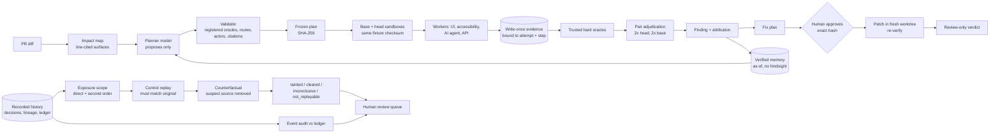

# Gauntlet: Gate + Recall

**CI passes because nobody wrote the test.** Gauntlet reads what a pull request changed, writes
the test that change deserves, proves the failure in isolated environments with an independent
oracle, and holds the fix for a human. When a bad change has already shipped, it works out
which past AI-agent decisions it actually affected.

## Two modes

**Gate (before merge).** Gauntlet maps the PR diff to the surfaces it touches (CSS, component,
route, agent tool, API). A planner model proposes attacks that cite the exact changed lines. A
validator rejects anything outside policy. The plan is hashed and frozen **before** any
environment exists. Each attack runs twice on the PR head and twice on the base in separate
sandboxes. A trusted oracle judges stored evidence, not the model's words. The verdict is one of
`confirmed_regression` (introduced by this PR), `confirmed_pre_existing`, `passed`, `suspected`,
`environment_error` or `not_tested`, with attribution. A fix plan only runs after a reviewer
approves its exact SHA-256. It is then re-verified: original attack, a variant, and the normal
user flow. Gauntlet never merges.

**Recall (after release).** Gauntlet reads the recorded history of an AI agent (decisions,
retrieved KB chunks, memory reads and writes, tool calls, ledger). From a suspect source, such
as a bad KB chunk, it follows recorded lineage to every exposed decision. That includes second
order: chunk → memory note → a later decision. For each exposed decision it replays a
**control** with every input pinned. The control must reproduce the original. Then it replays a
**counterfactual** with only the suspect source removed. The result is `tainted`, `cleared`,
`inconclusive` or `not_replayable`. A separate event audit checks every recorded tool call
against the authoritative ledger. Output is a review queue. Nothing is reversed or sent
automatically.

## Demo target: Cartwheel (synthetic shop)

| Change | What goes wrong | Gauntlet result (offline, reproducible) |
|---|---|---|
| "Add a floating Help button" | On narrow screens the Help widget covers **Place order** | `confirmed_regression`: head 2/2 fail, base 0/2. Also confirmed with real headless Chromium against real `next build` output |
| "Clarify the product description" | Nothing | `passed` (no false alarm) |
| "Let the support assistant request refunds" | The ownership check was deleted from the refund tool | Planner picks an **AI-agent** attack. The target's own TypeScript tool runs per revision; the ledger shows a refund to a non-owner on head only → `confirmed_regression`. The approved fix is re-verified → `fix_verified_review_required` |
| Recall on bad KB chunk `kb-117` | Chunk said "ownership was checked upstream" | 3 tainted (1 second-order through memory `mem-083`), 2 cleared, 1 not replayable. Audit: 3 violations, 1 inconclusive of 36 |

## Architecture



Code layout: `services/gauntlet/src/gauntlet` holds `contracts/` (Pydantic DTOs), `domain/`
(pure verdict rules), `ports/` (protocols), `planning/`, `analysis/`, `application/` (Gate,
Recall, repair, memory use cases), `workers/`, `verification/` (oracles), `integrations/`
(adapters), `composition.py` (picks fake / local / live adapters) and `settings.py` (the only
place that reads env vars). `apps/dashboard` is the Next.js UI. `apps/cartwheel` is the target.

## Sponsors: what each does and what has really run

Status is as of the last update to [`docs/SDK_VALIDATION.md`](docs/SDK_VALIDATION.md), which
holds the exact command for each live run. "Offline-tested" means fakes and mocked transports
only.

| Sponsor | Role in Gauntlet | Status |
|---|---|---|
| **Daytona** | Isolated base and head sandboxes restored from pinned snapshots with an identical fixture checksum | **Live:** snapshot creation and cold restore with verified preview receipts. Full Gate on Daytona: not run yet |
| **Anchor Browser** | Cloud browser that executes typed UI steps on the sandbox preview origin | Offline-tested; live not run. Demo uses `GAUNTLET_ANCHOR_REQUIRE_PROXY=0` (no egress proxy, weaker isolation, labeled) |
| **Arize AX** | Traces for planner, workers, oracles and replays; counterfactual experiments | Offline-tested; live not run. Never the oracle |
| **SurrealDB** | Run event log, lineage graph, recorded history | Ran against a local pinned SurrealDB image; hosted not run |
| **SurrealDB Agent Memory** | Typed, time-aware memory of verified findings that informs the next plan | Offline-tested; live not run |
| **ElevenLabs** | Spoken briefing from stored findings; read-only, cannot approve | Offline-tested; live not run |
| **Azure OpenAI** | Planner, fix proposer, model-played support agent, Recall model replay | Offline-tested; live not run. Bedrock adapter is also built (no AWS account) |
| **GitHub App** | Webhook → ChangeRequest → Gate → check run (checks only, never merges) | Offline-tested; App not installed yet |

Without keys every adapter falls back to a **labeled** offline adapter. Every report carries an
`adapters` block, and the dashboard shows an OFFLINE / live NOT RUN badge.

## Run it offline (two commands)

Needs Python 3.12+ with [`uv`](https://docs.astral.sh/uv/). Node 22+ is needed for the refund-tool demo.

```bash
uv sync
uv run python scripts/run_gate.py && uv run python scripts/run_recall.py
```

More: `run_gate.py --clean` (unrelated change), `--change refund-tool` (AI-agent attack),
`--a11y` (accessibility worker), `--memory local --learn` (memory), `scripts/run_repair.py`
(hash-approved fix). The dashboard and API are covered in [`docs/DEMO.md`](docs/DEMO.md); all
commands are in [`docs/RUNBOOK.md`](docs/RUNBOOK.md). Live runs: set keys in a gitignored
`.env.local`, add `RUN_LIVE_INTEGRATIONS=1`, and pass e.g. `--model azure --sandbox daytona
--browser anchor`.

## Safety design

- **The model only proposes.** No model-written shell, JavaScript, routes or oracles. Attacks are
  typed steps checked against registered targets, routes, synthetic actors and oracles. Repository
  text and page content are untrusted data.
- **Freeze before execution.** The plan hash is recorded before any sandbox is created.
- **Independent oracles judge evidence.** Evidence is stored write-once with a store-computed
  hash and is bound to run, attempt, environment, commit, fixture and step. Oracles re-read the
  bytes. A refund "promise" in chat is not a refund; only the ledger counts.
- **Confirmation needs reproduction and attribution.** At least two hard-oracle failures on head,
  and base runs to decide whether the PR introduced the bug.
- **Hash-bound, single-use human approval.** Changing one byte of the fix voids the approval. The
  patch touches only approved, non-protected paths (never tests, oracles, CI or lockfiles) in a
  fresh worktree. No auto-merge, deploy, refund or customer contact.
- **Recall never fabricates.** A failed control or missing recorded input gives `inconclusive` or
  `not_replayable`, never `cleared`. Lineage recorded after the incident window is ignored.
- **Secrets only from environment variables.** They never print. A missing key is reported by
  name only. Targets and data are synthetic.

Policy details: [`docs/TENANCY_AND_AUTH.md`](docs/TENANCY_AND_AUTH.md),
[`docs/SECURITY.md`](docs/SECURITY.md). Known limits: [`docs/SUBMISSION.md`](docs/SUBMISSION.md).

## For contributors and coding agents

Read [`AGENTS.md`](AGENTS.md) first, then [`docs/DEVELOPMENT_PLAN.md`](docs/DEVELOPMENT_PLAN.md),
[`docs/PHASES.md`](docs/PHASES.md), [`docs/CONTRACTS.md`](docs/CONTRACTS.md) and
[`CONTRIBUTING.md`](CONTRIBUTING.md). Checks: `uv run pytest -q`,
`uv run ruff check services/gauntlet scripts`,
`uv run --group live-providers mypy services/gauntlet/src`,
`uv run python scripts/export_schemas.py`.
